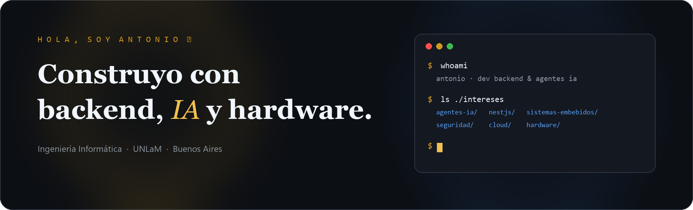
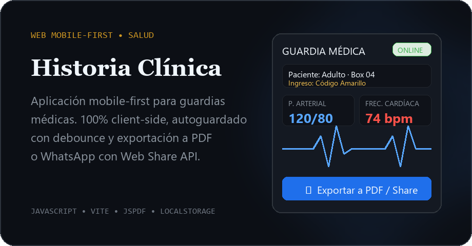
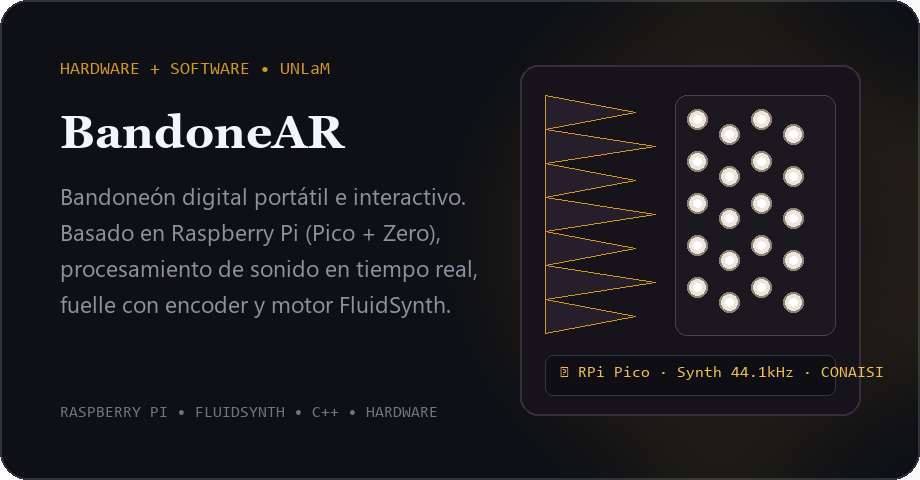
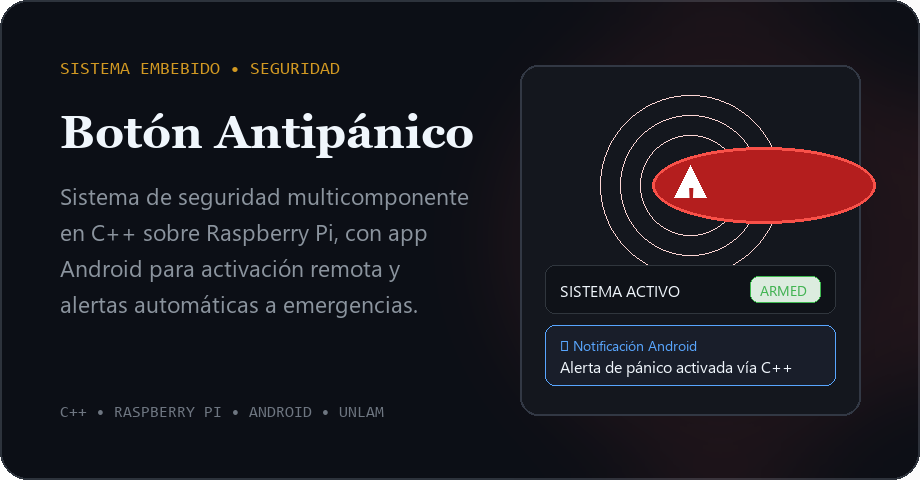
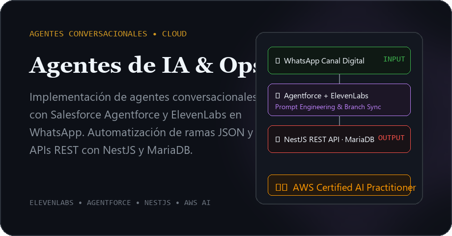

<!-- Header Banner -->

  

Estudio **Ingeniería Informática en la UNLaM** (último año) y me dedico al desarrollo **backend e integración de agentes de IA**. Me apasiona conectar lógica de servidor, automatización conversacional y soluciones de hardware aplicadas a problemas reales.

- 🤖 **Agentes de IA & Backend**: Desarrollo e integración de agentes conversacionales sobre **Salesforce Agentforce** y **ElevenLabs**, además de APIs REST escalables con **NestJS**, **TypeScript** y **MariaDB**.
- 📋 **[Historia Clínica de Guardia](https://github.com/Tonii325/web-historias_clinicas)**: Web app mobile-first, 100% client-side (sin backend), para agilizar el registro médico y exportar a PDF o WhatsApp. [Probalo acá](https://web-historias-clinicas.vercel.app).
- 🪗 **BandoneAR**: Proyecto final de carrera en UNLaM. Instrumento musical digital portátil basado en Raspberry Pi con procesamiento de señales en tiempo real y motor FluidSynth.
- 🚨 **Botón de Antipánico**: Sistema embebido en C++ sobre Raspberry Pi con activación remota desde app Android para notificaciones automáticas de emergencia.
- ☁️ Certificado como **AWS Certified AI Practitioner** y formándome activamente en seguridad web y herramientas de asistencia con LLMs.

---

### Proyectos

<table border="0" style="border: none; border-collapse: collapse;">
  <tr>
    <td width="50%" style="border: none; padding: 6px;">
      
    </td>
    <td width="50%" style="border: none; padding: 6px;">
      
    </td>
  </tr>
  <tr>
    <td width="50%" style="border: none; padding: 6px;">
      
    </td>
    <td width="50%" style="border: none; padding: 6px;">
      
    </td>
  </tr>
</table>

---

  <a href="https://tonii325.github.io">🌐 <b>Portafolio</b></a> &nbsp;&nbsp;•&nbsp;&nbsp;
  <a href="https://linkedin.com/in/antonio-solis-ab2232119">💼 <b>LinkedIn</b></a> &nbsp;&nbsp;•&nbsp;&nbsp;
  <a href="mailto:antoniosolis737@gmail.com">✉️ <b>Contacto</b></a>

